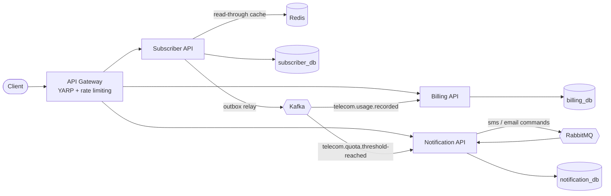

# Telecom Usage & Notification Platform

[](https://github.com/emircanozdag/telecom-platform/actions/workflows/ci.yml)

An event-driven microservice system in **.NET 8** that tracks mobile data usage, bills overage and alerts subscribers when they approach their quota — the kind of flow a telecom operator runs at scale.

Built to show production patterns rather than CRUD: a transactional outbox, idempotent consumers, optimistic concurrency, retry and dead-letter queues, cache-aside, and per-service databases.

## Architecture



| Service | Responsibility | Tech |
|---|---|---|
| **Subscriber API** | Subscribers, plans, usage recording, quota thresholds (80% / 100%) | ASP.NET Core minimal APIs, EF Core, PostgreSQL, Redis |
| **Billing API** | Consumes usage events and maintains monthly overage invoices | Kafka consumer, EF Core, PostgreSQL |
| **Notification API** | Turns quota events into SMS and email jobs and delivers them | Kafka consumer, RabbitMQ work queues, EF Core |
| **Gateway** | Single entry point, routing, per-client rate limiting | YARP |

### Request flow

1. `POST /api/subscribers/{id}/usage` updates the subscriber's usage and, **in the same database transaction**, writes `UsageRecorded` (and possibly `QuotaThresholdReached`) to an outbox table.
2. A background relay publishes outbox rows to Kafka, keyed by subscriber ID so each subscriber's events stay ordered.
3. **Billing** consumes `UsageRecorded` and adds the overage to that month's invoice.
4. **Notification** consumes `QuotaThresholdReached`, enqueues one SMS and one email job on RabbitMQ, and a dispatcher delivers them.

## Design decisions

- **Transactional outbox** (`Subscriber.Api/Outbox`): no dual write between the database and Kafka. Events are never lost when Kafka is down and never published for a rolled-back change. The relay locks rows with `FOR UPDATE SKIP LOCKED`, so several instances can run without double-publishing.
- **Idempotent consumers**: Kafka delivers at least once and offsets are committed only after the handler succeeds. Billing records each `EventId` in an inbox table in the same transaction as the invoice update, so redelivered events are never billed twice. Notification enforces uniqueness on `(EventId, Channel)`.
- **Optimistic concurrency**: concurrent usage reports for one subscriber race on PostgreSQL's `xmin` row version and are retried instead of overwriting each other (covered by an integration test).
- **Retry and DLQ**: failed notification sends are re-published with an attempt counter. After `MaxAttempts` they are rejected into a per-channel dead-letter queue for inspection. Set `Senders__SimulatedFailureRate` to watch this happen.
- **Cache-aside with graceful degradation**: subscriber reads are cached in Redis and invalidated on change. If Redis is down, the API falls back to the database instead of failing.
- **Database per service**: each service owns its schema and talks to the others only through events.
- **Domain logic in plain classes**: quota thresholds, period rollover and overage calculation live in `Subscriber` and `Invoice` and are unit tested without any infrastructure.

## Running it

Requirements: Docker. The .NET 8 SDK is only needed to run the tests or the services outside Docker.

```bash
docker compose up --build
```

Then, through the gateway on `http://localhost:8000`:

```bash
# Create a subscriber on the 5 GB plan
curl -s -X POST localhost:8000/api/subscribers \
  -H 'Content-Type: application/json' \
  -d '{"msisdn":"905321234567","email":"ayse@example.com","fullName":"Ayşe Yılmaz","planCode":"MINI-5GB"}'

# Use 4.5 GB, which crosses the 80% threshold
curl -s -X POST localhost:8000/api/subscribers/<id>/usage \
  -H 'Content-Type: application/json' -d '{"megabytes":4600}'

# Go past the quota so overage is billed
curl -s -X POST localhost:8000/api/subscribers/<id>/usage \
  -H 'Content-Type: application/json' -d '{"megabytes":1000}'

curl -s localhost:8000/api/billing/<id>/invoices
curl -s localhost:8000/api/notifications/<id>
```

| UI | URL |
|---|---|
| RabbitMQ management | http://localhost:15672 (guest / guest) |
| PostgreSQL | localhost:5433 (telecom / telecom) |
| Kafka (from the host) | localhost:9094 |

The credentials in `docker-compose.yml` and `appsettings.json` are for local development only.

## Tests

```bash
dotnet test
```

- **Unit tests**: quota thresholds, period rollover, overage billing and invoice rounding.
- **Integration tests** (`Subscriber.IntegrationTests`): the real API against PostgreSQL in a Testcontainers container. They cover validation, unique MSISDNs, atomic outbox writes, cache invalidation and concurrent usage updates. Docker must be running.

CI runs the full test suite and builds every service image on each push (`.github/workflows/ci.yml`).

## Project layout

```
src/
  BuildingBlocks/
    TelecomPlatform.Contracts/   integration events and topic names
    TelecomPlatform.Messaging/   Kafka publisher and at-least-once consumer base class
  Services/
    Subscriber/Subscriber.Api/   domain, outbox, cache, endpoints
    Billing/Billing.Api/         invoice domain, inbox, consumer
    Notification/Notification.Api/  RabbitMQ topology, dispatcher, senders
  Gateway/Gateway.Api/           YARP routes and rate limiting
tests/
  Subscriber.UnitTests/  Billing.UnitTests/  Subscriber.IntegrationTests/
```

## Possible next steps

- OpenTelemetry tracing across HTTP, Kafka and RabbitMQ
- Kubernetes manifests or a Helm chart
- Plan changes mid-period with prorated quotas
- Real SMS and email providers behind `INotificationSender`
